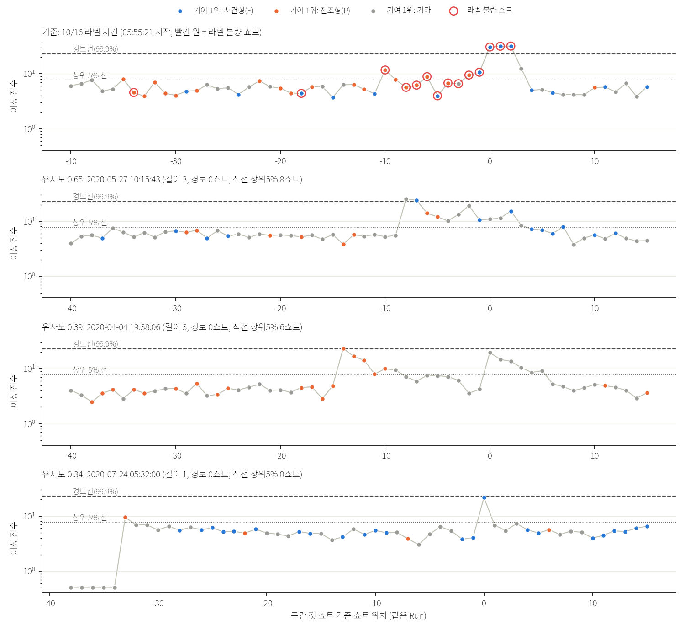

# 비라벨 데이터에서 10/16형 '전조 → 사건' 과정 찾기 (탐색)

- 지위: 탐색. 보고서·질의응답용. `final/`은 건드리지 않음.
- 정의 고정: 2026-10-08 09:14 (`date`), **코드 실행 전**. 결과를 보고 바꾼 것은 '사후'로 표시한다.

## 고정한 정의 (실행 전)

### 대상·모델
- **대상**: 우진2 CN7·RG3 비라벨 가동 쇼트 전부. `../unsup_search/common.py` 캐시를 쓰며, 제외 대상은 다음과 같다.
  - 비가동(배럴1 < 100℃)
  - 끼어든 이상 기록
  - 10쇼트 미만 Run
  - 라벨 쇼트 시각, 라벨 Run 앞뒤 60분
- **모델**: dev26(전 변수 인과 편차 21 + 관계 R1~R5 편차) + 국소 Mahalanobis k=300.
  - 학습 기준: 같은 제품·우진2 비라벨 중 CN7은 10/16 이전, RG3는 10/21 이전.
  - 전처리: 학습 중앙값·IQR → ±20 클리핑 → 결측 0.
  - 학습 쇼트를 점수화할 때는 이웃에서 **자기 자신을 뺀다**(leave-self-out).
- **경보선**: 학습 쇼트(자기 제외 점수)의 99.9% 분위.
- **상위 5% 선**: 학습 쇼트의 95% 분위.
- **기여**: 그 쇼트의 이웃 300개로 추정한 평균·정밀도로 d² = Σ z_j(Pz)_j를 나눈 비율이다.
  - 편차σ는 그 변수의 인과 강건 편차값(dv, MAD 단위)이다.

### 패턴 정의 (요청 그대로)
- **사건형 변수 집합 F**: 사출속도(Max_Injection_Speed), 사출시간(Injection_Time), 충전시간(Filling_Time), R1(rel_fill_speed)
- **전조형 변수 집합 P**: R2(rel_plast), 배럴1·2·3, 호퍼
- **경보 구간**: 같은 Run에서 연속으로 경보선을 넘은 쇼트 묶음
- **사건**: 길이 3 이상인 경보 구간이면서, 구간 쇼트 **평균** 기여의 1~3위에 F가 2개 이상
  - '평균'은 요청에 쇼트별인지 평균인지가 없어서 코드 작성 시 구체화한 것이다.
  - 쇼트별로 조건을 만족한 쇼트 수도 함께 적는다.
- **단발 사건**: 길이 1~2인 경보 구간이면서 같은 기여 조건
- **전조**: 구간 첫 쇼트 직전 30쇼트(같은 Run, 구간 제외) 안에서, 상위 5% 선을 넘고 기여 1위가 P인 쇼트가 2개 이상
- **전조형 구간(사건 없음)**: 위 조건을 만족하는 쇼트가 30쇼트 안에 2개 이상 모였는데 뒤에 사건·단발 사건이 없는 경우. 개수만 보고한다.

### 양성 대조
- 같은 모델로 10/16 라벨 쇼트(CN7)를 점수화한다. 위 정의가 실제 사건(05:55~05:57)과 사건 전 가스 쇼트를 잡는지 먼저 확인한다.

### 유사도 순위 (사용자 요청 '조금이라도 비슷한 것', 완화 기준, 실행 전 정의)
- **후보 단위**: 같은 Run에서 연속으로 **99% 분위**(학습 기준)를 넘은 쇼트 묶음. 경보선보다 낮은 문턱이다.
- **10/16 기준 벡터** (양성 대조 점수에서 계산):
  - E_c = 사건 3쇼트 평균 기여
  - E_d = 사건 3쇼트 평균 dv(방향 포함)
  - P_c = 사건 직전 30쇼트 중 상위 5% 선을 넘은 쇼트의 평균 기여
- **유사도** = 0.5 · s_E + 0.3 · s_P + 0.2 · s_L
  - s_E = ½ · cos(후보 평균 기여, E_c) + ½ · cos(후보 평균 dv, E_d)
  - s_P = cos(후보 직전 30쇼트 중 상위 5% 쇼트의 평균 기여, P_c). 그런 쇼트가 없으면 0
  - s_L = min(길이, 3) / 3
- 제품별 상위 10개를 보고한다. CN7 상위 3개는 10/16과 함께 시간축 그림으로 그린다.
- 같은 날 여러 후보가 있으면 모두 순위에 둔다.

### 로트 불량 비교
- ERR_FACT_QTY는 로트(계획일 + 시리얼) × 측면(LH/RH)별 첫 값이다.
- **사건일 값**: 그날 쇼트가 있는 로트들의 측면별 합.
- **비교 대상**: 같은 제품·우진2의 다른 날 같은 값의 평균과, 사건일의 백분위.
- 사건 쇼트가 속한 로트 자체의 값과 전 로트 평균도 함께 비교한다.

---

## 결과 (실행 2026-10-08 09:15, `python episode.py`, 약 1분)

### 0. 양성 대조 — 정의가 10/16을 잡는가: **잡는다**

같은 모델·정의로 CN7 라벨 쇼트를 점수화했다. 경보선은 22.84(학습 99.9%), 상위 5% 선은 7.77이다.

| 라벨 경보 구간 | 길이 | 판정 | 기여 상위 3 (평균 기여 %, 평균 편차σ) | 직전 30쇼트 전조 |
|---|---|---|---|---|
| **10/16 05:55:21** | 3 | **사건** | 사출속도 30% (+35.7σ), R1 25% (+46.5σ), 사출시간 23% (−12.8σ) | **4쇼트 → 전조 있음** |
| 10/27 00:56:21 (초기허용불량) | 4 | 경보 3연속(패턴 불일치) | 배압 36% (+63.9σ), R5 15%, 사출시간 13% (+121.6σ) | 0 |
| 10/30 02:11:54 | 1 | 단발 사건 | 배압 35% (+313.5σ), 사출시간 31% (+27.7σ), R1 9% | 1 |

그림의 첫 패널을 보면 10/16 사건 전 가스 불량 쇼트 대부분의 기여 1위가 전조형(주황)이다.

### 1. 기간별 경보 쇼트 수·비율

| 제품 | 기간 | 쇼트 | 경보(> 99.9%) | 경보 비율 | 상위 5% 비율 |
|---|---|---|---|---|---|
| CN7 | 학습 기간 안 (< 10/16) | 4,288 | 5 | 0.12% | 5.0% (정의상) |
| CN7 | 학습 기간 밖 (≥ 10/16, 라벨 시간대 ±60분 제외) | 3,719 | 5 | 0.13% | 4.2% |
| RG3 | 학습 기간 안 (< 10/21) | 11,395 | 12 | 0.11% | 5.0% |
| RG3 | 학습 기간 밖 (≥ 10/21) | 2,078 | **0** | 0% | 3.4% |

- 월별 경보 수는 다음과 같다.
  - CN7: 4월 1, 5월 2, 7월 1, 9월 1, 10월 5
  - RG3: 6월 1, 7월 11, 나머지 0
- RG3 경보 12개 중 11개가 7월이고, 그중 대부분은 7/17 하루에 몰려 있다.

### 2. 정의에 맞는 사례 목록

**CN7 (비라벨)**

| 시각 | Run | 길이 | 판정 | 기여 상위 3 | 직전 30쇼트 전조 쇼트 |
|---|---|---|---|---|---|
| 2020-09-07 10:10:51 | R0083 | 1 | **단발 사건** | 사출속도 22% (−33.5σ), 사출시간 20% (+35.7σ), R1 17% (+46.5σ) | 0 |
| 2020-10-17 23:49:29 | R0121 | 5 | 경보 3연속(패턴 불일치) | 계량위치 95% (−25.2σ), 충전시간 1%, 배압 1% | 1 |
| 2020-04-04 19:09:59 | R0019 | 1 | (패턴 불일치) | R2 33% (+16.9σ), R1 26% (−10.6σ), 계량시간 25% | 0 |
| 2020-05-27 10:06:51 | R0025 | 2 | (패턴 불일치: F 1개) | 사출속도 26% (−28.0σ), 배압 19%, R4 14% | 0 |
| 2020-07-30 01:23:08 | R0040 | 1 | (패턴 불일치) | R5·배압·사출압 (수십~수백σ, 기록 이상형) | 0 |

- **사건(3연속 + 패턴)은 이번 정의·탐색 범위에서 확인되지 않았다(0건).** 경보 3연속 자체는 1번 있었지만(10/17 23:49) 계량위치 단독 이상이라 패턴이 다르다.
- **전조를 동반한 사건·단발 사건은 이번 정의·탐색 범위에서 확인되지 않았다(0건).**
- 단발 사건 1건(9/7)은 기여 패턴이 10/16과 거의 같다(사출속도↓·사출시간↑·R1↑). 다만 전조는 확인되지 않았다(직전 30쇼트 전조 쇼트 0).
- 전조형 쇼트(상위 5% + 기여 1위 R2·배럴1~3·호퍼)가 30쇼트 안에 2개 이상 모였는데 뒤에 사건이 없는 경우가 **28번** 있다.
  - 즉 '전조' 정의만으로는 특이성이 낮다.
  - 라벨 기간에서도 같은 경우가 5번 있다.

**RG3 (비라벨, 10/16 CN7 패턴을 그대로 적용)**

| 시각 | Run | 길이 | 판정 | 기여 상위 3 | 전조 쇼트 |
|---|---|---|---|---|---|
| 2020-07-17 07:32:53 | R0128 | 3 | **사건** | 배압 32% (**−580σ**), 충전시간 24% (+15.1σ), R1 24% (+34.5σ) | 1 |
| 2020-07-17 07:43:20 | R0128 | 1 | **단발 사건** | R1 47% (−48.0σ), 충전시간 15% (−14.6σ), R4 12% | 1 |
| 7/17 그 밖 4건, 6/23·7/7·7/8 각 1건 | | 1~2 | 패턴 불일치 | R5·계량시간·사출압·형체시간·배압 등 | 0~1 |

- RG3의 '사건' 1건은 7/17 07:28~07:46에 경보가 반복된 Run 안에 있다.
- 다만 기여 1위가 배압 −580σ다. 원값을 보면 07:29에 평균 배압이 102 → 약 15로 계단식으로 떨어졌고(설정 변경 추정), 그 직후 충전시간이 3.4 → 3.9초로 늘었다.
- 10/16의 사출속도·충전 이상보다 **공정 조건 변경에 따른 반응**에 가깝다고 본다(해석).
- 전조는 1쇼트로, 정의(2개 이상)에 못 미친다.
- 전조형 구간(사건 없음)은 20번이다.

### 3. 사례 날짜의 로트 불량 수량 (ERR_FACT_QTY, 그날 로트들의 측면별 합)

| 사례 | 그날 LH / RH | 다른 날 평균 LH / RH | 그날 백분위 LH / RH |
|---|---|---|---|
| CN7 9/7 단발 사건 | 5 / 6 | 25.7 / 31.9 | 40% / 47% |
| CN7 10/17 경보 5연속 | **28 / 75** | 25.2 / 30.4 | **81% / 87%** |
| CN7 5/27 경보 + 유사도 1위 | 3 / 2 | 25.7 / 31.9 | 34% / 32% |
| CN7 7/24 유사도 3위 | **50 / 50** | 24.7 / 30.9 | **85% / 83%** |
| RG3 7/17 사건·단발 사건 | 18 / 33 | 47.9 / 34.8 | 52% / 72% |

- 정의상 사건·단발 사건이 있었던 날(9/7, 7/17)의 로트 불량은 평균 수준이거나 그 이하다.
- 로트 불량이 높았던 날은 10/17(계량위치 경보 5연속)과 7/24(R1 단독, 경보선 바로 아래)다. 두 날 모두 10/16형 '전조 → 사건' 과정은 이번 정의·탐색 범위에서 확인되지 않았다.
- 로트 수량은 하루 전체 기준이라, 그 쇼트가 실제로 불량이었는지는 알 수 없다.

### 4. 10/16과 가장 비슷한 사례 (유사도 순위, 완화 기준) — 그림 `fig/similar_cn7.png`

**CN7 상위 5**

| 순위 | 시작 | 길이(> 99%) | 경보 | s_E (사건 유사) | s_P (전조 유사) | 직전 상위 5% 쇼트 | 유사도 | 기여 상위 3 |
|---|---|---|---|---|---|---|---|---|
| 1 | **2020-05-27 10:15:43** | 3 | 0 | 0.63 | 0.43 | 8 | **0.65** | R1 41% (+20.4σ), 계량시간 33%, 사출속도 16% (+8.8σ) |
| 2 | 2020-04-04 19:38:06 | 3 | 0 | −0.04 | 0.69 | 6 | 0.39 | 절환압·R5·사이클 |
| 3 | 2020-07-24 05:32:00 | 1 | 0 | 0.56 | 0 | 0 | 0.35 | R1 58% (+17.2σ), 충전시간 15% (+6.7σ), R4 |
| 4 | 2020-05-27 22:02:36 | 1 | 0 | 0.05 | 0.80 | 2 | 0.33 | 배럴2 47% (+8.0σ), 금형3, R2 |
| 5 | 2020-05-27 10:12:22 | 2 | 0 | 0.06 | 0.56 | 5 | 0.33 | R5 42%, 계량시간, R1 |
| (참고) 7위 | 2020-09-07 10:10:51 | 2 | 1 | 0.38 | 0 | 0 | 0.32 | 사출속도·R1·R5 (= 단발 사건) |

**가장 비슷한 사례는 5/27 10:06~10:17 (Run R0025)이다.** 아래 셋이 한 Run 안에 모여 있다.
- 10:06~10:07: 경보 2쇼트(사출속도 −28σ)
- 이어서 9쇼트(10:09~10:17)가 모두 상위 5% 선 위에 머문다. 기여 1위는 R2 2쇼트, R5 2쇼트, 계량시간 3쇼트, R1 2쇼트다(전조형은 2쇼트뿐).
- 10:15~10:17: R1·사출속도가 주도하는 쇼트 3개(99% 초과, 경보선 아래)

차이점도 분명하다.
- 순서가 10/16과 반대다. 큰 이상(사출속도·R4)이 먼저 오고, 계량 관련 상승이 뒤따른다.
- 마지막 구간은 경보선을 넘지 않았다.
- 그날 로트 불량은 평균 이하다(3 / 2).

**RG3 상위 3**: 4/24 02:55(유사도 0.42, R1 단독 1쇼트, 전조 4), 7/17 07:17(0.38, 충전시간·R1), 10/21 12:51(0.37, 배럴1·R1). 모두 경보선 아래다.

### 5. 확인되지 않은 것 명시
- **10/16과 같은 '전조 → 사건(경보 3연속 + 충전 패턴)' 과정은 CN7 비라벨에서 이번 정의·탐색 범위로는 확인되지 않았다(0건).**
- RG3의 '사건' 1건(7/17)도 전조 정의에 못 미치고, 기여 성격이 다르다.
- CN7 비라벨의 경보 3연속은 1번(10/17)뿐이며 패턴 불일치다.

### 사후 변경
- 정의·문턱 변경은 없다.
- 그림 범례 위치만 겹침 때문에 옮겼다(값 변경 없음).
- 결과를 본 뒤 RG3 7/17 배압 원값과 5/27 쇼트별 기여 1위를 추가로 확인해 해석 문장을 고쳤다(사후 확인, 수치·정의 변경 없음).

## 5줄 요약
1. **같은 과정은 이번 정의·탐색 범위에서 확인되지 않았다.** CN7 비라벨 8,007쇼트에서 10/16형 '전조 → 경보 3연속 + 충전 패턴'은 0건이다. 같은 정의는 10/16 라벨 사건은 정확히 잡는다(전조 4쇼트 + 3연속 사건).
2. **조금이라도 비슷한 것**은 CN7 9/7 10:10 단발 사건(기여 패턴이 거의 같지만 전조 없음)과 5/27 10:06~10:17(경보 2쇼트 → 9쇼트 연속 상위 5% → R1·계량시간 쇼트, 순서가 반대이고 끝 구간은 경보선 미만)이다. 유사도 1위는 5/27(0.65)이다.
3. **그날 로트 불량은 높지 않았다**(9/7은 40~47%, 5/27은 32~34% 백분위). 로트 불량이 높았던 10/17(81~87%)·7/24(83~85%)는 다른 형태(계량위치 단독, R1 단독)다.
4. **RG3**는 7/17에 정의상 '사건' 1건이 있지만, 평균 배압이 102 → 15로 계단 변화한 직후의 반응(배압 −580σ, 충전시간 증가)이고 전조는 1쇼트다. 10/21 이후 비라벨에서는 경보가 0건이다.
5. **한계**: 기준 사례가 10/16 한 건이다. 전조 정의는 사건 없이도 28번(CN7) 충족되어 특이성이 낮다. 로트 불량은 하루·로트 단위라 쇼트별 불량과 연결할 수 없다. 유사도 가중치(0.5/0.3/0.2)는 임의로 정한 값이다.

## 파일
| 파일 | 내용 |
|---|---|
| `episode.py` | 점수화(자기 제외 국소 Mahalanobis), 경보 구간·패턴 판정, 유사도 순위, 로트 불량, 그림 |
| `fig/similar_cn7.png` | 10/16 기준 + CN7 유사도 상위 3 시간축 |
| `outputs/alarm_segments.csv`, `similarity_rank.csv`, `summary.json` | 전체 결과 (git 제외) |
